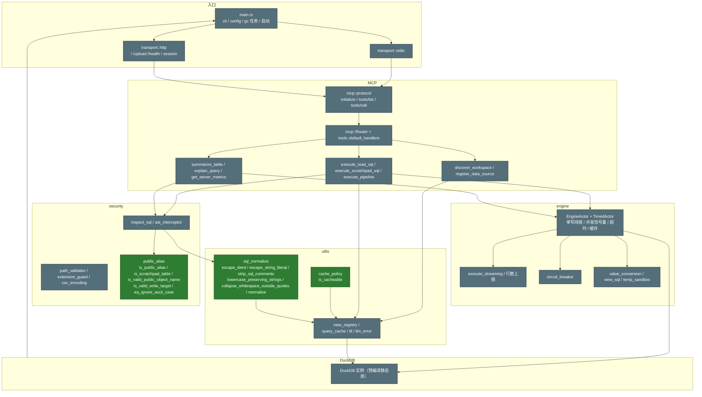

# pADA v0.1.0

面向 agent 的数据分析服务端（MCP over DuckDB）：把文件与上传数据注册成 `vw_<16hex>` 视图，让模型只用 SQL 完成分析。

**pADA = p + ADA（Agentic Data Analysis）**。

## 1. 项目简介

| 组件 | 产物 | 职责 |
| --- | --- | --- |
| `pada`（lib） | rlib | 引擎 actor、MCP 协议与 8 个工具、SQL/路径/扩展安全管线、stdio 与 streamable-http 传输 |
| `pADA`（bin） | `pADA.exe` / `pADA` | MCP 服务端进程：读 `config.toml`，按 `transport` 起 stdio 或 HTTP |
| `libs/libduckdb-sys` | vendored patch | 不下载、不 bindgen、不编译 DuckDB：只把预生成绑定复制进 `OUT_DIR`，并链接 `DUCKDB_LIB_DIR` 或 `duckdb-cache/<target>/` 里的静态库 |

**一次分析的数据流**：客户端 `initialize` → `tools/list` → `discover_workspace` 拿到 `dataset_name → vw_<16hex>` → 用 `summarize_table` 看列统计 → `execute_read_sql` 查询；需要落表时 `execute_scratchpad_sql` 写 `tm_<16hex>`（`CREATE TABLE` 自动发布 `vw_<派生hex>`），或 `execute_pipeline` 一次提交多步；`explain_query` 只看计划不执行。所有 SQL 经 `security::inspect_sql` 判定后才进 `EngineActor`（单写线程 + 读连接同一 DuckDB 实例）；文件注册与视图别名由 `utils/view_registry` 持久化到 `state_dir/.duckdb_views.json`，重启自动恢复。

**三条硬边界**：读只允许裸 `vw_<16hex>`；写只允许 `ai_scratchpad` 下的 `tm_<16hex>`；文件系统只允许 `workspace_dir` / `state_dir` 之内（符号链接解析后仍要满足）。

## 2. 构建

只支持 release 构建（`[profile.release]`：`lto = true`、`codegen-units = 1`、`strip = true`）。无网络环境可加 `--offline`。

```
sh build.sh              # Linux：先编 DuckDB gcc 静态库，再 cargo build --release
build.bat                # Windows：/full（默认）或 /lite
cargo build --release --features http --bins   # 已有 DuckDB 静态库时
```

* `build.sh` 需要 DuckDB 源码（默认 `./duckdb-1.5.4`，不存在则用 `../duckdb-1.5.4`，也可用 `DUCKDB_SOURCE_DIR` 指定），用 `cmake` + `ninja` + `gcc` 编出 `libduckdb_static.a`、`libduckdb_generated_extension_loader.a`、`libjson_extension.a`、`libparquet_extension.a`、`libcore_functions_extension.a` 与 `duckdb.h`，缓存到 `duckdb-cache/x86_64-unknown-linux-gnu-gcc/`；`sh build.sh rebuild` 强制重建。
* 手工调用 cargo 时链接器需要：`DUCKDB_LIB_DIR`、`DUCKDB_INCLUDE_DIR`、`DUCKDB_STATIC=1`，Linux 另加 `DUCKDB_CXX_LIB=stdc++`（默认 `c++`）。
* `build.bat` 走预编译库：把 `duckdb_static.lib` 与 `duckdb.h` 放进 `duckdb-cache\`（或设 `DUCKDB_LIB_DIR`）；`/lite` 用 `duckdb-cached` 特性以压缩依赖树。
* DuckDB 版本钉在 **1.10504.0**（`Cargo.lock`）：`duckdb::types::Value` 的变体集合在 1.10506 变了，跨版本会编译失败。
* 产物：`target/release/pADA.exe`（Windows）或 `target/x86_64-unknown-linux-gnu/release/pADA`（Linux）。

## 3. 运行与配置

`pADA -c config.toml`（默认读当前目录的 `config.toml`）。`config.example.toml` 是完整键集：

| 键 | 默认 | 含义 |
| --- | --- | --- |
| `workspace_dir` | `./data_workspace` | 可注册/上传的数据文件目录（模型不能直接读路径） |
| `temp_dir` | `./.duckdb_tmp` | 每个 actor 的 DuckDB 临时库目录 |
| `state_dir` | `./.duckdb_state` | 服务端私有状态（视图注册表、快照），模型不可达 |
| `extension_directory` | `""` | 扩展目录；空则用可执行文件所在目录 |
| `allowed_extensions` | `["spatial","excel"]` | 启动时 sidecar `LOAD` 的白名单；文件缺失只告警 |
| `max_memory` / `stream_limit` | `4GB` / `5000` | DuckDB 内存上限 / 单次结果行上限 |
| `max_result_bytes` | `10485760` | 单次结果序列化字节上限（超限报错，不返回半截） |
| `query_timeout_secs` / `spatial_query_timeout_secs` | `60` / `120` | 普通查询 / `ST_*` 查询墙钟超时 |
| `max_columns` / `cell_truncate_chars` | `500` / `1000` | 列数上限 / 单元格截断长度 |
| `excel_max_size_mb` | `500` | 单文件 Excel 上限 |
| `transport` / `host` / `port` | `stdio` / `127.0.0.1` / `3100` | `streamable-http` 时必须给 token |
| `http_bearer_token` / `allow_remote_http` / `allowed_origins` | 占位符 / `false` / 本机 | HTTP 鉴权与 CORS；远程部署必须显式打开 |
| `max_concurrent_queries` / `cache_capacity` | `8` / `128` | 并发查询上限 / 归一化 SQL 结果缓存条数（`0` 关闭） |
| `gc_interval_secs` | `600` | 会话、临时表、数据文件的后台清理周期 |
| `temp_table_ttl_secs` | `86400` | `tm_<16hex>` 存活时间（1 天） |
| `data_file_ttl_secs` | `604800` | `workspace` 数据文件存活时间（7 天，按 mtime） |
| `underscore_data_file_ttl_secs` | `31536000` | `_` 前缀数据文件的存活时间（1 年） |

到期清理会同时删文件、`vw_` 视图与注册项；任一项设 `0` 即关闭该项过期。临时表只在进程内存在。

`spatial` / `excel` 需要把官方 `linux_amd64`（或对应平台）的 `spatial.duckdb_extension`、`excel.duckdb_extension` 放在二进制旁；缺失时启动日志告警 `Extension files not found for: …`，`ST_*`/`read_xlsx` 不可用，其余功能不受影响。

HTTP 端点：`POST /`（MCP JSON-RPC，需 `Authorization: Bearer <token>`；`initialize` 响应头回 `Mcp-Session-Id`）、`POST /upload`（multipart 单文件，需 session；ZIP 逐条目校验后自动注册）、`GET /health`。会话上限 10,000；上传单文件 500 MiB，ZIP 最多 500 条目、单条目 500 MiB、解压总量 2 GiB。

## 4. MCP 工具（8 个）

| 工具 | 作用 | COST / 约束 |
| --- | --- | --- |
| `discover_workspace` | 一次返回所有已注册表/视图的 schema 与行数 | `1 + N` 次查询；列统计与样例行默认关闭 |
| `register_data_source` | 把 `workspace_dir` 里的文件名注册成视图 | 0 次查询；只收文件名，不收路径 |
| `execute_read_sql` | 只读 SELECT，只允许裸 `vw_<16hex>` | 1 次查询；必须先 discover |
| `execute_scratchpad_sql` | 只写 `tm_<16hex>`（CREATE/INSERT/UPDATE/DELETE/ALTER/DROP） | 每语句 1 次查询；建表自动发布 `vw_` 别名 |
| `execute_pipeline` | 一次提交多步：`kind=write` 写 `tm_`，`kind=query` 读 `vw_` | 每步 1 次查询 |
| `summarize_table` | 单表完整列统计 + 推荐聚合 | 2 次查询；只收 `vw_` |
| `explain_query` | 只出执行计划，不执行 SQL | 1 次廉价查询；可对 DDL/DML 用 |
| `get_server_metrics` | 版本、在线连接、已执行查询、`stream_limit`、各超时上限 | 0 次查询 |

## 5. 函数图谱

统计（`src/`，不含 `libs/`）：**41** 个 `.rs`、**7,896** 行、**334** 个 `fn`；另有 vendored `libs/libduckdb-sys`（3 个 `.rs` + 生成绑定）。

图例：绿色 = 已被形式化证明（Creusot）；灰色 = 未证明。



## 6. 形式化验证（Creusot 0.13）

工具链：**Creusot 0.13**（Rust → WhyML）+ **why3find**（Why3 1.6 + Z3 / Alt-Ergo / CVC4 / CVC5），nightly 固定版本。验证目标是父仓库里的独立 crate `core/`，它用 `include!` 把三个纯逻辑模块**原样**嵌入（不复制）：

```
core/src/lib.rs
├── pub mod public_alias   { include!("../../src/security/public_alias.rs"); }
├── pub mod sql_normalize  { include!("../../src/utils/sql_normalize.rs"); }
└── pub mod cache_policy   { include!("../../src/utils/cache_policy.rs"); }
```

运行与结果：远端 Linux（192.168.9.114）上 `core/` 内 `cargo creusot --span-mode off` → **`Proved (83 files)`**，退出码 0。

### 6.1 逐函数契约

| 模块 | 函数 | 被证契约 | 实现来源 |
| --- | --- | --- | --- |
| `public_alias` | `is_public_alias` | `result == is_public_alias_bytes(name@.to_bytes())`（精确刻画：19 字节、`vw_` 前缀、16 位 ASCII hex） | 生产实现（`#[cfg_attr(creusot, ensures)]`） |
| `public_alias` | `is_scratchpad_table` | `result == is_scratchpad_table_bytes(...)`（`tm_` + 16 hex） | 生产实现 |
| `public_alias` | `is_valid_public_object_name` | `result == is_valid_public_object_name_logic(parts@)`（四种白名单形态的双向刻画） | 生产实现 |
| `public_alias` | `is_valid_write_target` | `result == is_valid_write_target_logic(parts@)` | 生产实现 |
| `public_alias` | `eq_ignore_ascii_case` | `result == true ==> len(a) == len(b)` | 生产实现 |
| `public_alias` | `is_ascii_hexdigit_byte` | `result == is_hex_byte(b)` | 生产实现 |
| `public_alias` | `ascii_lower_u8` | `result@ == ascii_lower_int(b)` | 生产实现 |
| `public_alias` | `is_range` / `is_main` / `is_ai_scratchpad` | 各自 `result == <对应 _bytes 谓词>` | 生产实现 |
| `sql_normalize` | `escape_ident` | `is_quoted_escape(result@.to_bytes(), name@.to_bytes(), 34u8)`（输出确为双引号包裹、内嵌引号已加倍） | 镜像实现（`#[cfg(creusot)]`） |
| `sql_normalize` | `escape_string_literal` | `is_quoted_escape(result@.to_bytes(), value@.to_bytes(), 39u8)` | 镜像实现 |
| `sql_normalize` | `collapse_whitespace_outside_quotes` | `len(result) <= len(s)`；无 ASCII 空白时结果不变；`result == collapsed_seq(s, 0, 0, false)` | 镜像实现 |
| `sql_normalize` | `normalize` | `len(result) <= len(sql)`；`is_trimmed_semi(result)` | 镜像实现 |
| `sql_normalize` | `strip_sql_comments` | 输出逐字节 `< 128`（保持 ASCII 域） | 镜像实现 |
| `sql_normalize` | `lowercase_preserving_strings` | 输出逐字节 `< 128` | 镜像实现 |
| `cache_policy` | `is_cacheable` | `has_volatile(sql) ==> result == false`（含 volatile 构造的 SQL 必判不可缓存） | 镜像实现 |
| `cache_policy` | `contains_*_from`（21 个词族分支） | 各分支 `result == has_*_from(hay, i)`（逐个 volatile 词族的循环不变量刻画） | 镜像实现 |

`sql_normalize` / `cache_policy` 的镜像实现与生产实现是**同文件里的两套 `#[cfg]` 分支**（生产分支另带 `len >= 2` 这类弱契约，在 creusot 构建下被 cfg 排除）。因此这两块的证明等价于"逐行对读的抄写件已被证"，对读责任不在工具里。

### 6.2 建模假设与偏差

| 项 | 内容 |
| --- | --- |
| `str` 入参 | 建模为字节序列（`@.to_bytes()`）；`char` 侧另用 `u8 as char` 的 ASCII 分支，域收在 `< 128` |
| `extern_spec` | 为 `str::as_bytes`、`String::new`、`String::push` 手写规格（creusot-std 0.13 缺这些），属信任假设 |
| 外部 crate | `sqlparser` 等一律按 opaque 处理，依赖其语义的性质显式记为 assume |
| 未覆盖 | 整个服务端（actor/并发、HTTP 传输、8 个 handler、SQL 执行、视图注册与恢复、TTL、文件落盘）均**未**证明；`is_cacheable` 的 volatile 词表只证"命中即拒绝"，不证"不命中必然可缓存" |
| 并发 | 曾用 **loom** 对 `actor.rs` 的 4 处交错建模（`OperationRegistry` 状态机、availability guard Drop、`OnceLock` 中断句柄、满队列 shutdown）。该代码与 `scripts/verify-loom.*` 门禁不在本树 |

本树**不含**测试与证明代码（`core/`、`tests/`、`scripts/`、`fuzz/`、`proptest-regressions/` 均已移除）；上面的结论与契约来自父仓库的验证工程，本文件只做记录。

## 7. 目录结构

```text
pADA/
├── src/config/      配置加载与校验（含相对路径解析）
├── src/engine/      DuckDB actor、超时与并发、流式结果、视图 SQL、临时 sandbox、熔断
├── src/mcp/         JSON-RPC 协议、Router、stdio transport、8 个工具
├── src/security/    SQL 检查、AST 拦截、路径校验、扩展白名单、编码探测、别名/表名规则
├── src/transport/   stdio 与 streamable-http（上传、session、CORS）
├── src/utils/       SQL 归一化（可证）、缓存策略（可证）、视图注册表、结果缓存、TTL
├── libs/libduckdb-sys/  vendored 绑定 + 链接脚本（链接预编译 DuckDB 静态库）
├── Cargo.toml  Cargo.lock
├── build.sh         Linux 构建（编 DuckDB 静态库 + cargo build --release）
├── build.bat        Windows 构建（用 duckdb-cache\duckdb_static.lib）
├── config.example.toml  完整配置键集
└── README.md  LICENSE
```

## 8. 许可证

MIT，版权与完整条款见 `LICENSE`（Copyright (c) 2026 lulu）。
